# @noon/flow-kit

The noon app as a **React UI kit for clickable prototypes**. It has noon's design tokens, a component library, a motion system and **18 ready-made flows (156 screens)** ported from **bappzaar** (the noon React Native app) and the noon Figma files.

<table>
  <tr>
    <td align="center">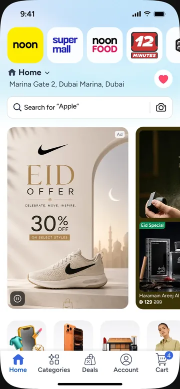<br /><sub>Home · <code>/homepage</code></sub></td>
    <td align="center">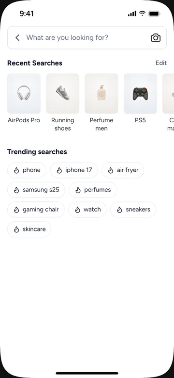<br /><sub>Search · <code>/search</code></sub></td>
    <td align="center">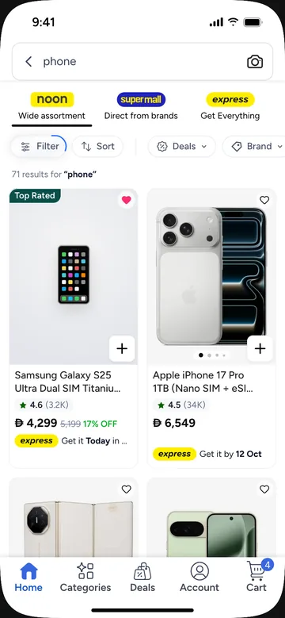<br /><sub>Listing · <code>/plp?query=phone</code></sub></td>
    <td align="center">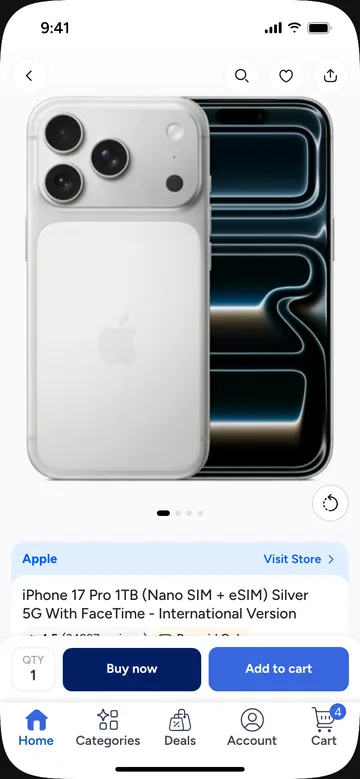<br /><sub>Product · <code>/pdp?productId=…</code></sub></td>
  </tr>
  <tr>
    <td align="center">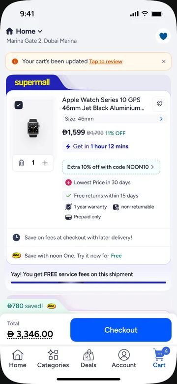<br /><sub>Cart · <code>/cart</code></sub></td>
    <td align="center">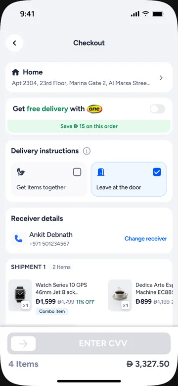<br /><sub>Checkout · <code>/checkout</code></sub></td>
    <td align="center">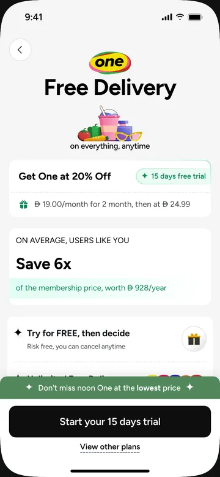<br /><sub>noon One · <code>/noon-one</code></sub></td>
    <td align="center">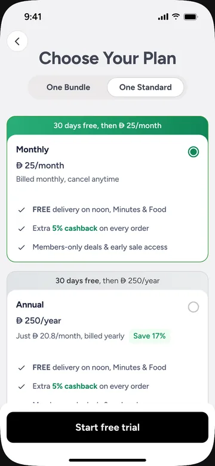<br /><sub>Plans · <code>/noonone/plans</code></sub></td>
  </tr>
  <tr>
    <td align="center">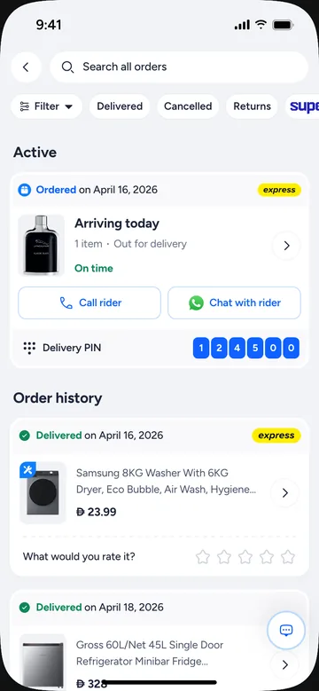<br /><sub>Orders · <code>/orders</code></sub></td>
    <td align="center">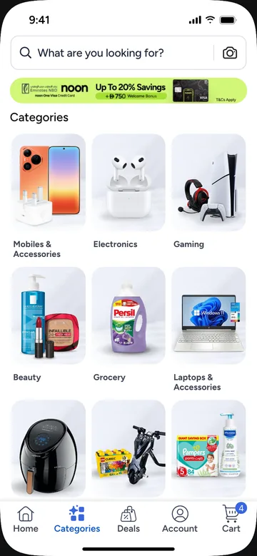<br /><sub>Categories · <code>/categories/categories</code></sub></td>
    <td align="center">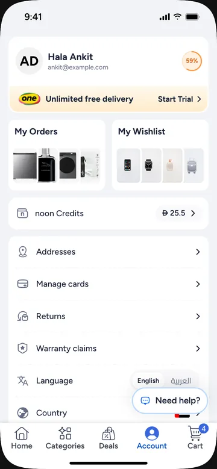<br /><sub>Account · <code>/account/account</code></sub></td>
    <td align="center">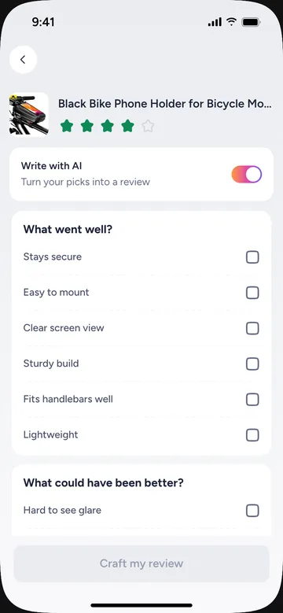<br /><sub>Rate &amp; review · <code>/reviews/rate</code></sub></td>
  </tr>
</table>

**Who it's for**

| You are… | Use it to… | Start at |
|---|---|---|
| A designer or PM | Click through real noon flows, demo an idea, hand a working prototype to engineering | [Run it locally](#run-it-locally) → [Open any screen](#open-any-screen) |
| Someone building with AI | Ask Claude to build or restyle a noon page from a prompt, a Figma link or a screenshot | [Build screens with AI](#build-screens-with-ai) |
| A front-end engineer | Use noon's tokens, components or whole flows in your own React app | [Use it as a package](#use-it-as-a-package) |
| A contributor | Port a new screen from bappzaar / Figma, fix one, or add a flow | [Contribute](#contribute) |

---

## Run it locally

You need **Node ≥ 20** and **git**.

```bash
git clone https://github.com/arnabdebnath07/noon-app-skill.git
cd noon-app-skill
npm install
npm run dev
```

Open **http://localhost:5180**. You get a phone with the noon app on it. Tap around: the tab bar, the search, product cards, the cart and checkout all work, and the cart, wishlist and noon One state carry across screens.

If port 5180 is taken, Vite picks the next free one and prints it in the terminal.

## Open any screen

Every screen has a URL, so you can link straight to it, bookmark it or paste it into a ticket.

| Page | URL |
|---|---|
| Home | `/homepage` |
| Search | `/search` |
| Search results (listing) | `/plp?query=iphone` |
| Product page | `/pdp?productId=N70211593V` (iPhone 17 Pro, live data) |
| Cart | `/cart` |
| Checkout | `/checkout` |
| Order confirmation | `/order-confirmation` |
| Orders | `/orders` |
| Order tracking | `/order-tracking?orderId=o1` |
| Categories | `/categories/categories` |
| Deals | `/deals/deals` |
| Account | `/account/account` |
| Addresses | `/addresses` |
| Payment cards | `/cards` |
| noon One (non-member landing) | `/noon-one` |
| noon One plans | `/noonone/plans` |
| Manage membership | `/manage-membership` |
| Return details | `/returns?productId=p5` |
| Rate & review | `/reviews/rate` |
| Wishlist | `/wishlist/wishlist` |

Any screen also opens as `/<flow>/<screen>`; the full list of all 148, with their sources, is in [`.claude/resources/screens.md`](./.claude/resources/screens.md). Back on a page you opened directly goes to its logical parent.

## Flows

| Flow | Screens | What's in it |
|---|---:|---|
| `home` | 2 | Marketplace switcher, address, rotating search, the bappzaar home CMS feed (Eid hero, ad banners, carousels) |
| `search` | 2 | Recent and trending searches, live suggestions, hand-off to results |
| `categories` | 4 | Live CMS: 29 category tiles × 175 sub-categories, inline drill-down |
| `deals` | 1 | The dynamic deals tab |
| `plp` | 3 | Listing with filter / sort pills, sheets; bars hide on scroll like the app |
| `pdp` | 4 | Storefront PDP: gallery parallax, variants (in-place switching), delivery, offers, reviews, recommendations, sheets |
| `cart` | 8 | All flows cart design: shipment groups (supermall, Global, express, market), progress bars, carousels, coupons, cobrand card, payment offers |
| `checkout` | 22 | All flows checkout design: address, noon One banner with the CTA reveal, delivery instructions, shipments, points & vouchers, Pay With, donation, summary, slide to pay, confirmation, failure |
| `orders` | 4 | Order list (pinned header, filter pills), tracking, cancel |
| `returns` | 5 | History → submission → details, plus sheets |
| `reviews` | 9 | R&R 2.0: rate, write with AI, photos, success |
| `account` | 17 | Profile, security, notifications, preferences, country and language |
| `address` | 10 | Address book, map pin, form |
| `cards` | 8 | Payment cards |
| `noonone` | 22 | noon One acquisition: entry points, landing (non-member prod design), plans, payment, success |
| `membership` | 24 | noon One management: manage, change / upgrade, cancel, family, referrals |
| `wishlist` | 2 | Wishlist and empty state |

Each flow folder (`src/flows/<flow>/`) has a `MAPPING.md` and/or `FIGMA-MAPPING.md` that records where every value came from in bappzaar or Figma.

---

## Build screens with AI

The repo ships **Claude skills**: they know noon's tokens, components, assets, motion and every flow, so Claude can build a new page that looks and behaves like the app. There are three ways to use them; pick by where you work.

| Where you work | Use | What the skills can do there |
|---|---|---|
| **Terminal, inside this repo** (Claude Code) | nothing to install: `.claude/skills/` loads automatically | plan, **build**, register and screenshot-check screens in `src/flows/` |
| **Terminal, any other project** (Claude Code) | the `noon-ui` plugin from this repo's marketplace | plan and review with the full design knowledge; building needs a checkout of this repo |
| **Claude app** (claude.ai / desktop) | upload the plugin zip | plan, write specs, review designs against noon's system; no repo access |

| Skill | Use it for |
|---|---|
| `noon-ui` | The main skill: any noon page or flow. Routes to a screen skill when one fits; holds the design-system references, the brain map and the validation steps. |
| `home-page` · `search` · `pdp` · `cart` · `checkout` | Home and campaign pages · search and results · product page · cart · checkout |
| `orders` · `returns` · `reviews` · `account` · `noon-one` | Orders and tracking · returns · ratings and reviews · account and settings · noon One membership |

In this repo the skills are `/noon-ui`, `/home-page` …; from the plugin they are namespaced `/noon-ui:noon-ui`, `/noon-ui:home-page` …. You can also just describe the page; Claude picks the skill by its description.

### 1. In the terminal, inside this repo (recommended for building)

```bash
git clone https://github.com/arnabdebnath07/noon-app-skill && cd noon-app-skill
npm install
npm run dev          # http://localhost:5180 — the phone preview
claude               # in a second terminal, from the repo folder
```

Then ask in plain language, or start with the skill:

```text
/home-page build a Ramadan campaign landing page
/checkout add a gift-wrap step before payment
update the PDP to match this Figma: https://www.figma.com/design/<file>?node-id=<node>
build a loyalty page with tiers, rewards and a history screen
```

Claude first asks the brain map what already exists, reads only what it names, writes a plan, builds with the kit's components and tokens, registers the screen at a URL and checks it with screenshots (`node .claude/skills/noon-ui/scripts/snap.mjs <flow>`). You can run the same retrieval yourself:

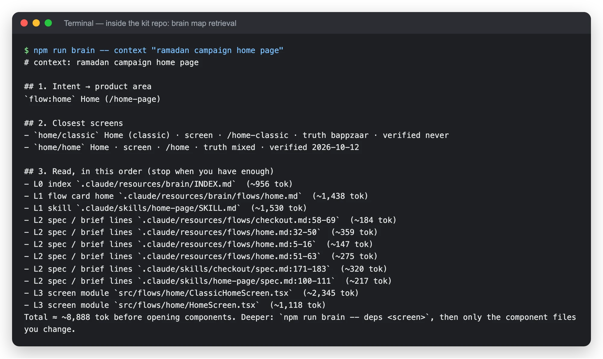

### 2. In the terminal, in any other project (the plugin)

```bash
claude plugin marketplace add arnabdebnath07/noon-app-skill
claude plugin install noon-ui@noon-flow-kit
```

(or `/plugin marketplace add …` and `/plugin install noon-ui@noon-flow-kit` inside a Claude Code session). Add `--sparse .claude-plugin plugins` to the first command to skip downloading the app's assets. Start a new session, or run `/reload-plugins`.

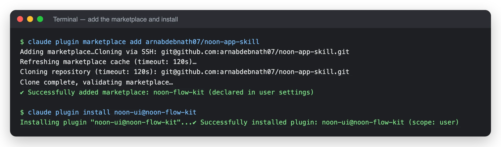

`claude plugin details noon-ui@noon-flow-kit` shows what you got: 11 skills, no hooks or MCP servers, about 2.8k tokens added to each session (each skill's full text loads only when it is used).

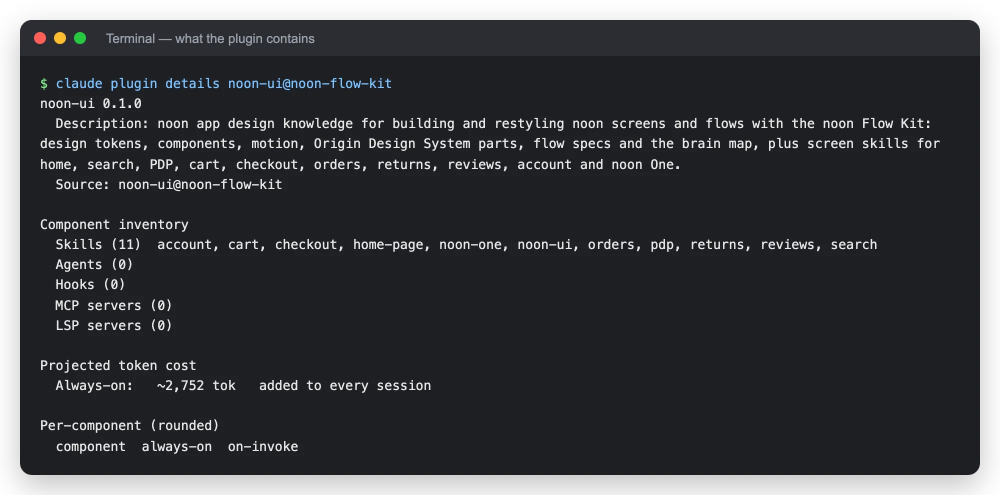

Use it like any skill. Outside the repo it plans from the bundled brain map and specs, and says what it can't confirm without the kit's source:

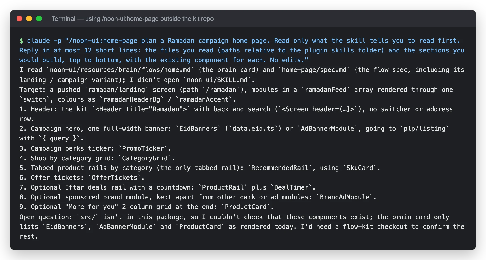

Update with `claude plugin marketplace update noon-flow-kit` then `claude plugin update noon-ui@noon-flow-kit`; remove with `claude plugin uninstall noon-ui@noon-flow-kit` and `claude plugin marketplace remove noon-flow-kit`. Inside this repo, disable the plugin (`claude plugin disable noon-ui@noon-flow-kit`) or every skill appears twice.

### 3. In the Claude app

1. In this repo run `npm run release:zip`. It writes `dist-plugin/noon-ui-<version>.zip` with `.claude-plugin/plugin.json` at the archive root.
2. In the Claude app open **Your plugins → Upload local plugin**, drop the zip on **Plugin file** and press **Upload**.
3. Ask for a noon page as you would in the terminal. The app has no access to this repo, so it plans, writes specs and reviews designs; build the screens in the terminal (option 1).

An uploaded plugin does not update itself: upload the zip of each new version. If you uploaded single skills before (`npm run skills:package`, shown as `anthropic-skills:noon-ui` …), delete them in **Settings → Skills** so they don't duplicate the plugin's.

### Other agents

`plugins/noon-ui/skills/` is a standard Agent Skills package (one folder per skill with a `SKILL.md`). Copy **all** its folders, side by side, into the skills directory your agent reads. What needs Claude Code or this repo: [docs/distribution/PACKAGE-NOTES.md](./docs/distribution/PACKAGE-NOTES.md). Plugin install, troubleshooting and removal: [plugins/noon-ui/README.md](./plugins/noon-ui/README.md); releasing: [docs/distribution/RELEASING.md](./docs/distribution/RELEASING.md).

### How the skills stay accurate

- `.claude/skills/` and `.claude/resources/` are the only source; the plugin, the zip and the Agent Skills package are generated from them (`npm run resources:build` regenerates everything, `npm run release:check` verifies the package).
- `.claude/resources/brain/` is the brain map the skills read first: an index, one card per flow, and component / token / motion / journey cards, generated from the code. See [its README](./.claude/resources/brain/README.md).
- `npm run skill:check` validates every skill against the code (file paths, `--nk-*` variables, routes, coverage, and that the brain map is current).

---

## Use it as a package

```bash
npm install @noon/flow-kit react react-dom
```

```tsx
import { NoonPrototype, homeFlow, pdpFlow, cartFlow, checkoutFlow } from '@noon/flow-kit';
import '@noon/flow-kit/style.css';

export default function Demo() {
  return <NoonPrototype flows={[homeFlow, pdpFlow, cartFlow, checkoutFlow]} initialRoute="home/home" />;
}
```

> Needs React 19 and a bundler that understands ESM and `new URL(..., import.meta.url)` assets (Vite, webpack 5, Next.js, Rspack…).

| Import | What it is |
|---|---|
| `@noon/flow-kit` | Everything below, plus `NoonPrototype`, `Navigator` / `useNav`, `DemoStore`, `PhoneFrame`, motion presets and recipes, mocks |
| `@noon/flow-kit/components` | The component library only: Button (+ NoonButton presets), Text, Screen, Header, SearchBar, ProductCard, Price, Tag, Switch, Checkbox, Spinner, Toast, HtmlText, Divider, OriginIcon, Lottie… |
| `@noon/flow-kit/tokens` | Design tokens as data: `colors`, `palette`, `spacing`, `radius`, `type`, `shadow`, `layout`, component tokens, `ref.*` helpers |
| `@noon/flow-kit/data` | Shared mock data (products, catalogue) |
| `@noon/flow-kit/flows` | `allFlows` and every flow definition |
| `@noon/flow-kit/flows/<id>` | One flow, e.g. `@noon/flow-kit/flows/checkout` (smallest bundle) |
| `@noon/flow-kit/style.css` | All kit CSS (tokens as CSS variables, fonts, component and flow styles). Import once. |

The package is ESM with one module per source file and `sideEffects` set, so bundlers only include what you import. Images, Lotties and fonts load on demand.

**Navigation.** Screens are addressed as `flow/screen`; friendly names live in `src/kit/routes.ts`:

```ts
const nav = useNav();
nav.push('plp', { query: 'iphone' });    // same as 'plp/listing'
nav.push('checkout');                     // a flow opens on its initial screen
nav.sheet('pdp/variants', { productId }); // bottom sheet
nav.back();
```

**Theming.** All styling reads CSS variables generated from `src/foundations/tokens.ts` (`--nk-color-*`, `--nk-palette-*`, `--nk-type-*`, `--nk-space-*`, `--nk-radius-*`…). Override them at runtime:

```tsx
<NoonPrototype flows={allFlows} tokens={{ colors: { brand: '#FEEE00', cta: '#3866DF' } }} />
```

Fonts: Noontree (bundled), with the dirham sign (U+E001) for every price; Cairo for RTL. The `rtl` prop flips the whole prototype.

**Icons.** System icons are the Origin Design System set: `<OriginIcon name="cart-plus" />`, `<OriginIcon name="heart" filled />`. The catalogue is in [`.claude/skills/noon-ui/references/icons.md`](./.claude/skills/noon-ui/references/icons.md).

---

## Contribute

Read **[CONTRIBUTING.md](./CONTRIBUTING.md)** and **[CLAUDE.md](./CLAUDE.md)** first. The short version:

- **Port, don't invent.** For a screen that exists in the app: analyse the source, map every value, then implement. Read bappzaar **master** read-only (`git -C ~/bappzaar show origin/master:<path>`), write the flow's `MAPPING.md` / `FIGMA-MAPPING.md`, then build from it.
- **Tokens only.** No raw hex, font or radius values in components or flows; use `var(--nk-*)` in CSS and `ref.color(...)` / `<Text variant>` in TSX. Values that only one flow needs go in that flow's `tokens.ts`.
- **Reuse components** from `src/components`; a flow-only part goes in `src/flows/<flow>/components/`.
- **Every screen** is wrapped in `<Screen>`, gets a URL, a `source` and `notes`, and passes the checks below.
- **Prices** use the dirham sign (`currency` from `src/mocks/products.ts`), never "AED".

### Project layout

```text
src/
  app/            dev preview only (the phone page); not in the package
  components/     central component library
  foundations/    tokens.ts, palette.ts, generated CSS variables
  motion/         presets, recipes, screen transitions, haptics
  kit/            NoonPrototype, Navigator, routes, DemoStore, membership, tab-bar scroll
  flows/<flow>/   index.ts (defineFlow), screens, components/, data.ts, tokens.ts, MAPPING.md
  mocks/          products, phones, categories (demo catalogue)
  data/           shared catalogue data
  assets/<flow>/  images, icons, Lotties (shared ones in assets/shared/)
.claude/
  skills/         the AI skills (noon-ui + screen skills)
  resources/      screen index, patterns, tooling, per-flow briefs
docs/screens/     README screenshots
scripts/          checks, screenshots, asset tools, generators
```

### Scripts

| Command | What it does |
|---|---|
| `npm run dev` | Dev preview at http://localhost:5180 |
| `npm run verify` | Typecheck (app + library), token lint, asset check, library build. Run before every PR. |
| `npm run check:routes` | Opens every screen and fails on console errors (needs the dev server; `PORT=<port>` if it isn't on 5180) |
| `npm run test:journeys` | Walks the core user journeys in a browser and screenshots each step |
| `npm run lint:tokens -- -v <path>` | Lists raw colour / font literals in a folder |
| `npm run assets:check` | Asset size budget and duplicate check |
| `npm run assets:optimize` | Re-encodes assets (slow on the whole tree; prefer running it on new files) |
| `npm run skill:check` | Validates the AI skills against the code |
| `npm run resources:build` | Regenerates `.claude/resources/screens.md`, the categories index, the brain map and the plugin |
| `npm run skills:package` | Zips the skills for the Claude app |
| `npm run release:build` | Regenerates the `noon-ui` plugin + marketplace from the skills (also run by `resources:build`) |
| `npm run release:zip` | Zips the plugin for the Claude app (**Your plugins → Upload local plugin**) → `dist-plugin/noon-ui-<version>.zip` |
| `npm run release:check` | Checks the plugin / marketplace / skills package (metadata, versions, paths, duplicates, `claude plugin validate`) |
| `npm run new-flow -- loyalty "noon Loyalty" "Profile"` | Scaffolds a new flow and registers it |
| `npm run icons:import -- <folder>` | Imports Origin icons exported from Figma |
| `node scripts/shot.mjs <flow/screen> <out.png>` | Screenshot of one screen (`--scroll`, `--click`, `--type`, `--wait`; `PORT=` for another port) |
| `npm run visual:snap -- <dir>` / `npm run visual:diff -- <base> <dir>` | Pixel regression snapshots |

### Troubleshooting

- **A script can't find the app:** the checks and screenshot scripts assume port 5180. If `npm run dev` printed another port, prefix the command with it, e.g. `PORT=5182 npm run check:routes`.
- **`check:routes` reports a one-off `createRoot` error:** that's a hot reload landing mid-run; run it again.
- **`skill:check` says the screen index is stale:** run `npm run resources:build`, then `skill:check` again.
- **Typecheck errors in a file you didn't touch:** someone else's work in progress; check `git status` before fixing it.

## References

| Source | What it covers |
|---|---|
| bappzaar (`origin/master`) | The noon React Native app: behaviour, copy (`marketplaces/noon/locale/translations/noon-en.json`), style values. Every flow's `MAPPING.md` cites the files. |
| Figma `Af34gfmhQ1D0wstXUEHSIF` · All flows | Current home top, cart, checkout, noon One landing, bottom nav |
| Figma `iRE9RwO94eMAyW3j3XKNXW` · Homepage Revamp 2025 | Home feed modules |
| Figma `2ldJbjmQq4RkhnrNFCfXQB` · Storefront | PDP (in stock, out of stock, newer model) |
| Figma `xPr9Ln37JGSBGvNtrsyD0y` · PDP Redesign | PDP delivery information |
| Figma `BaWAAGW7zmdSTkXNXqPcAJ` · Cart 2.0 | Cart |
| Figma `zURu7GI7sq77fjdXKrouvo` · Checkout 2.0 | Checkout (earlier variant) |
| Figma `KzR8dy12uT8CtgBRHHY6Qx` · R&R 2.0 | Rate & review flow |
| Figma `wFRKiKskxZ4vjIHbDVvngJ` · Origin Design System | System and bottom-nav icons |

## Release

Versions follow semver, and every user-facing change adds a line to [CHANGELOG.md](./CHANGELOG.md) under *Unreleased*. `npm publish` runs `npm run verify` first; check the tarball with `npm run pack:check`. The `noon-ui` plugin shares the version: release steps in [docs/distribution/RELEASING.md](./docs/distribution/RELEASING.md).
